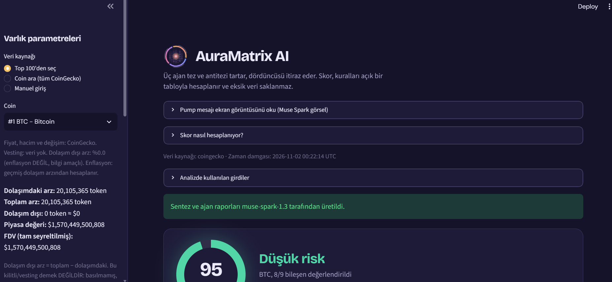

<p align="center"></p>

# AuraMatrix AI — Multi-Agent Crypto Risk Intelligence

> Meta Global AI Developer Hackathon · Track: **Build for Your World** · Indie Developer
>
> 🚀 **Live demo:** https://auramatrix-ai.streamlit.app
>
> **Educational risk analysis. Not investment advice.**
>
> 🌐 Available in **English** (default) and **Turkish**: switch in the sidebar. The agents answer in the selected language.

<p align="center"></p>

## The problem
Retail crypto investors lose money to FOMO: buying after vertical pumps, ignoring token-unlock
pressure and hidden supply inflation. Most tools show one number or one opinion. AuraMatrix shows
**what is measured, what is assumed, and what is missing**.

## What it does
1. **Live market data** (CoinGecko): Top 100 or search any coin; 90-day price history.
2. **Real risk statistics** computed from that history: annualized volatility, Sharpe, max drawdown,
   bootstrap **Monte Carlo VaR/CVaR** (10,000 simulations), tail thickness (excess kurtosis).
3. **Transparent Aura-Score** (0–100): `100 − Σ penalties` over 9 components with an explicit
   threshold table (`core/scoring.py`). The UI renders the same table and a per-analysis breakdown.
   If price history is missing the category is **UNCERTAIN**, never "safe". Every component that cannot be evaluated
   (e.g. no vesting data) costs an explicit **−5 uncertainty premium**, so missing data can never raise the score
   (an asset with a missing component cannot exceed 95).
4. **Meta Model API multi-agent dialectic** (`muse-spark-1.3`): three agents run in parallel
   (Macro/Inflation = thesis, On-chain/Tokenomics = thesis, Quant risk = antithesis), then a fourth call
   writes the Hegelian synthesis. Agents receive explicit `UNAVAILABLE` markers and are told not to
   invent missing data. API failures are shown as errors — **no mock text is ever presented as AI output**.
5. **1/3/5/10-year inflation projection**: effect of net supply inflation and staking APY on a position's
   share of supply (no price prediction).
6. **Devil's Advocate agent**: a fourth Meta agent that tries to refute the score using ONLY the analysis data
   (data gaps, short window, bootstrap assumptions, unvalidated thresholds) and then debates the user's counter-arguments.
7. **What-if agent (tool calling)**: ask "what if volume drops to 1M USD?"; the Meta model calls the real scoring code as a tool (`rescore`) instead of guessing, and the UI shows every tool call and its result.
8. **Scenario stress test**: shock size (in the asset's own daily σ) and volatility multiplier presets re-run the
   Monte Carlo and show VaR/CVaR changes. Assumption-based "what if", not a forecast; no macro-event model is claimed.
9. **Risk radar** (no AI involved): one axis per score component, drawn from the same penalty table; a dashed marker shows components with no data.
10. **Market context** in the sidebar (information only, not scored): supply cap and how much of it is still unissued, 7-day change, distance from all-time high.
11. **Bilingual UI (EN/TR)**: every label, rule name, stress preset and agent prompt is localized from one dictionary (`core/i18n.py`); scoring logic uses language-neutral codes, so the score is identical in both languages.
12. **Auditability**: data source + UTC timestamp on every report, full input panel, CSV export of the
   price series for independent re-computation.

## Use of Meta AI tooling
- **Meta Model API, Chat Completions** (`muse-spark-1.3`): 3 parallel agents + synthesis + Devil's Advocate debate (multi-turn), strict data-availability and unit rules, structured JSON output.
- **Multimodal input** (`muse-spark-1.3` image understanding): reads screenshots of pump/hype posts, extracts visible coins, promises and pressure tactics; image text is treated as data, never as instructions.
- **Image generation** (`muse-image-1.0`, `/v1/images/generations`): optional abstract graphic whose composition follows the risk category. It carries no numbers.
- **Tool calling** (`muse-spark-1.3`): the What-if agent calls the real scoring code as a function (`rescore`) instead of guessing; every call and result is shown in the UI.
- **Muse Code** (Meta's coding agent, `muse-spark-1.3`): wrote the automated test suite for the scoring rules (`tests/test_scoring.py`, 16 tests).
- *Not used yet:* `muse-voice-transcribe-1.0`, `sam-3.1`, `muse-wonder-1.0`, open-weight models.

## What existed before the hackathon vs. what was built during it
| Before the hackathon (declared by the developer) | Built during the hackathon (Oct 26 – Nov 4) |
|---|---|
| Streamlit prototype with manual inputs | Meta Model API integration: 3 parallel agents + synthesis, error handling |
| Simple rule-based modules (Taleb/Kahneman/Hegel/Markowitz/Fama stubs) | Live CoinGecko data, coin search, 90-day history |
| Randomly generated demo universe | Real Sharpe/volatility/drawdown/Monte Carlo VaR/CVaR |
| Placeholder fallback text on API errors | Transparent 9-component scoring + methodology UI |
| | Supply-growth-based inflation (replacing a mislabeled proxy), timestamps, CSV audit export |
| | Screenshot reader (vision) + aura image (muse-image-1.0), Devil's Advocate, stress test, UI theme |
| | 1/3/5/10-year projection, one-click launcher, secret handling |
| | Uncertainty premium for missing data, risk radar, supply-jump warning, back-test script and honest validation report |
| | English/Turkish UI switch, What-if agent with Meta tool calling |

> The "before" column is the developer's own declaration. This repository was created on Nov 2 from the local working folder,
> so the pre-hackathon prototype is not part of its Git history.

## How this was built (AI-assisted development)
This project was built with the help of AI coding assistants, including Meta's **Muse Code**, which wrote the test suite in `tests/`. The developer set the product direction and decisions
(consumer protection against crypto hype, honesty over polish, what to measure and what to refuse to claim), chose the data sources,
ran and tested every feature on a live app, and rejected or reworked results that were misleading (for example, the back-test
showed the score adds nothing beyond volatility, and that is reported rather than hidden). AI assistants wrote and refactored much of the code
under that direction. All Meta Model API outputs shown in the app are real model calls; there is no mock text.

**What to look at as new work for this hackathon:** the right-hand column of the table above. The pre-hackathon prototype
(left column) was a manual-input Streamlit mock with random data and no Meta integration; none of the demo features depend on it.

## Data, assets and licenses
- Market data: [CoinGecko](https://www.coingecko.com) public API (free tier). Data powered by CoinGecko.
- AI: Meta Model API (`muse-spark-1.3`, `muse-image-1.0`) using the developer's own API key (never committed).
- Fonts: Bricolage Grotesque and DM Sans via Google Fonts (open licenses). Logo, icons and graphics in `assets/` were created for this project.
- Libraries: Streamlit, NumPy, Requests, pandas. Code is released under the MIT License (`LICENSE`).

## Run it
```bash
pip install -r requirements.txt
cp .env.example .env        # then put your MODEL_API_KEY inside
streamlit run app.py        # or double-click AuraMatrix_Baslat.bat on Windows
```
Run the tests (no API key or internet needed):
```bash
pip install pytest
python -m pytest tests -q   # 16 tests for the scoring rules
```
`.env` is git-ignored. **Never commit API keys.**
No key in `.env`? Paste your own Meta Model API key into the sidebar field (kept only in your browser session). Without any key, the score, risk statistics, radar, stress test and projection still work; only the Meta agents are disabled.

## Validation: a first back-test (and what it showed)
We did not want to ship a score without checking whether it means anything, so `backtest.py` tests it on 30 large coins
over one year of CoinGecko daily data (90-day look-back, 30-day look-forward, a new window every 7 days; results in `backtest_results.md`).
Only the history-based components can be tested (not vesting, supply growth or market cap).

- **Within the same day, the score ranks coins in the expected direction** (average rank correlation with the following
  30-day maximum drawdown: **+0.30**, 36 dates). A naive baseline that uses only 90-day volatility did better (**+0.43**).
  So in this sample **the score adds nothing beyond volatility as a predictor**; its value is transparency and explicit handling of missing data, not forecasting.
- **Pooled across all dates the correlation was negative (-0.16)**, and it flipped between the first half (-0.36) and the second half (-0.00) of the year: market-wide moves dominate that number.
- **Two components pointed the wrong way:** Sharpe (+0.30) and max drawdown (+0.27), i.e. coins with strong or deep recent history were not safer afterwards.
  Removing them barely changed the within-day result (+0.30 to +0.31/+0.32), so **we did not change the score**: tuning on the same data would be over-fitting.
- Limits: a single year, 30 surviving large coins, overlapping windows, no significance testing. This is a sanity check, not proof.
  A fair next step is re-testing on a different period before changing any threshold.

## Known limitations (honest list)
- Score thresholds are expert assumptions and are not calibrated. A first back-test (see Validation) found the score does not beat a plain volatility baseline.
- Vesting/unlock data has no free source; it is user-entered (otherwise "unknown").
- Inflation is derived from 90-day circulating-supply change (market cap ÷ price) — approximate. The data source can revise its circulating-supply method overnight (we saw an 18% one-day jump in a tracked coin); the app warns when the series has a jump above 5% in a day.
- Sharpe assumes a 0% risk-free rate; VaR uses bootstrap resampling of 90 daily returns.
- CoinGecko free tier is rate-limited.
- FOMO index measures only upside momentum; a low value does not imply safety.
- Stress scenarios are parameter assumptions (σ multiples), not predictions of specific macro events.
- No on-chain whale/liquidation data: no reliable free source was verified, so it is deliberately not claimed.

## Structure
```
app.py                  Streamlit UI
main.py                 Meta Model API client + agents (reads MODEL_API_KEY from .env)
matrix_engine.py        Data fetching + orchestration
core/scoring.py         Transparent score rules (single source of truth)
core/i18n.py            All UI/prompt text, English + Turkish
core/quant_metrics.py   Volatility, Sharpe, drawdown, Monte Carlo VaR/CVaR, supply growth
core/projection.py      1/3/5/10-year inflation projection
core/radar.py           Risk radar (SVG) drawn from the score breakdown
backtest.py             Back-test of the score on 30 coins (see Validation)
tests/test_scoring.py   16 tests for the scoring rules (written with Meta Muse Code)
demo/                   Demo captions and a fictional pump-post image used to test the screenshot reader
core/*                  Taleb tail-risk, Kahneman FOMO, Markowitz Sharpe, Fama anomaly, Hegel synthesis
```
